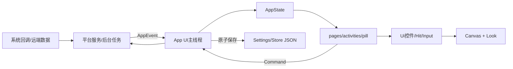

# Island For Mac 架构

本文描述当前定制源码，最后核对于 2026-11-12。产品名称为 Island For Mac；内部 crate、可执行文件 `poni`、环境变量 `PONI_*`、bundle id `com.oyenza.poni` 与 Poni 数据路径保持兼容。

## Workspace 与依赖

|模块|职责|
|---|---|
|`poni-core`|不依赖 UI 的设置、JSON存储、待办、专注状态机、日历/农历、文件引用、歌词与系统读数模型；共享设计尺度与主题色映射|
|`studio-diorama`|无第三方依赖的场景主题绘制，从传入时间生成画面|
|`poni`|共享页面/控件/命令与平台适配；Mac 使用 AppKit、Core Graphics、Core Text，Windows 使用 Win32、Direct2D、WinRT|

没有 Web 前端、CSS、数据库或 ORM。依赖通过 `Cargo.lock` 锁定，不能为重构引入另一套 UI、请求或状态框架。Mac HTTP 已由 URLSession 适配；IMAP、Gmail OAuth、歌词服务各自保留协议生命周期。

## 数据流和线程边界



UI 主线程拥有 `AppState`，页面处理本地交互并输出 `Command`；网络、钥匙串和文件内容校验不进入绘制流程。服务通过 `EventSink` 返回事件。页面出现等待状态不能伪造成功；异步回写继续核对歌曲、请求、账户 revision、暂停、删除与取消状态。

`mac/app.rs` 保留窗口、计时器、事件/命令分派和平台生命周期；业务编排按完整职责放在 `mac/app/codex.rs`、`mail.rs`、`weather.rs` 的 `impl App` 中。它们仍操作同一 UI 主线程状态，不增加代理对象、共享锁、线程或转发层。

## 状态归属

- `Settings` 是持久化偏好，`Store` 是待办、文件引用和专注记录。字段、版本迁移及旧字段透传保持兼容。
- `AppState` 聚合服务快照及跨页面协调状态；`PageUiState` 和页面动画缓存仅用于当前运行，不写成第二份业务存储。
- `mail::MailState` 持有账户快照、预览、译文和本次运行的界面状态。`UnreadSummary` 区分未知、精确值及已知下限，避免从显示文字反推数字；服务器未读数与岛内未查看提醒独立。
- `codex::Inbox/Conversation` 持有消息、草稿、发送回执和附件元数据，只驻留内存。服务端发送确认与不确定状态继续由原协议处理。
- 专注状态机仍在 core；`focus.rs` 承接自然结束后的统计、裁剪、保存、提醒和声音，平台循环调用它，页面只绘制和发起用户操作。
- 日历标记使用 `TaskList::day_marks`，复用与右侧列表相同的日期可见性规则，今天承接旧未完成任务，其他日期按计划日显示。

## 路由、页面与设置

路由是 `PageKind`，不是 URL。`pages/mod.rs` 集中处理可见标签、页面高度/切换和绘制，配置仍使用稳定的 page key。设置由齿轮打开，不作为顶部标签。至少保留一个可进入的页面。

|页面|职责与消费者|
|---|---|
|音乐|播放器元数据、专属来源歌词、浏览/返回当前句、自定义当前句颜色、播放进度与系统音量/静音；Pill 独立布局复用共享歌词和命令|
|今天|六行完整月历、农历、切月/选日、待办日期标记与右侧所选日期待办；Mac 天气支持手选城市、本地记忆及显式点击定位|
|文件暂存区|本地文件引用、内容去重、缩略图、打开/显示位置/拖入拖出/移除/清空/撤销；删除引用不删除真实文件|
|专注|专注/短休/长休、暂停/继续/重置/跳过、自然完成统计与提醒|
|系统|按能力显示 CPU/GPU/内存/磁盘/网络/电池/功耗；只在需要时启动采样|
|邮件（Mac）|多邮箱下拉、状态和数量、最近邮件、预览、系统翻译及打开 Apple Mail；账户表单位于设置内|
|Codex（Mac）|提醒分组、等待回答、原会话对话、草稿、回执及本地附件预览；`pages/codex/conversation.rs` 专门负责对话绘制|
|通知|仅 Windows 包身份/授权支持时提供，Mac 无此可见入口|
|快捷设置|日常偏好和“全部设置”入口，完整设置仍使用原窗口行为|

高级设置的十类入口为通用、外观、灵动岛、音乐与歌词、文件暂存区、邮件、弹出提示、标签页、专注、Codex 提醒。`settings_window/model.rs` 定义内容、配置操作和栏目；父模块管理视图、滚动、命中与动画，两个平台的 settings_host 承载同一内容。原生邮箱安全输入及颜色面板继续由 AppKit 处理。

隐藏的 Oyenza 页与旧事件、账单/日历数据契约仍存在，界面没有新登录入口。更新模型与 Windows 更新流程保留，Mac 定制版不启动上游自动更新，不应因为文件不可见就删除共享消费者。

## 绘制、字体与资源

`poni-core/design.rs` 集中字号、间距、控件高度及圆角。颜色仍由 `geom::palette` 定义，`Look` 负责深/浅主题转换，不能用新硬编码颜色绕过映射。`text.rs` 提供两平台共用的 `TextStyle/Weight/Align`；gfx 只负责平台测量和绘制。Mac 正文使用系统字体，中文交给 Core Text 系统回退；主题 Outfit 字体选择保留。数字通过 `tabular` 使用等宽数字，用户歌词色通过 `exact_color` 保留。

空闲停止连续帧；有限动画结束后休眠。锁屏、显示器关闭和节能继续影响服务与动画。天气符号为静态，城市搜索仍只在输入后去抖请求，没有为装饰图标保留 4 Hz 唤醒。重构没有新增依赖、线程、后台轮询或持久化字段。

## 数据与安全兼容

Mac：`~/Library/Application Support/Poni/` 保存设置和数据，`~/Library/Caches/Poni/` 保存缓存，`~/Library/Logs/Poni/` 保存日志。Windows 继续使用 APPDATA/LOCALAPPDATA 下的 Poni。`PONI_HOME` 供独立测试隔离，不用于迁移真实用户数据。

邮件密码仍只经安全输入框和钥匙串。拒绝授权后保留阻断标记，只有明确重新授权操作才能重试；不能通过界面重构放宽 ACL 或保存明文密码。本机固定自签名仍可能受 macOS 跨更新 cdhash 授权约束，不承诺永久免授权。请求编码复用 core RFC3986 编码；Gmail OAuth 表单继续保留空字段，不能替换成跳过空值的 URL 查询构造器。

## 构建与验证

```sh
cargo test --workspace --locked
cargo check --workspace --all-targets --locked
cargo build -p poni --locked
cargo clippy --workspace --all-targets --locked
cargo fmt --all --check
poni --render <输出目录> --theme pill --width 480
poni --render <输出目录> --theme pill --codex
```

宽度 480–900 DIPs 对应产品设置范围。离屏场景只使用虚构数据，不监听消息或连接邮箱；新增账户下拉和无歌词音乐场景。`mac/render/interaction_tests.rs` 用真实 Canvas/Hit/Input 检查设置导航、城市中文输入、日期选择、音乐命令与邮件筛选预览。它不替代系统输入法、网络、钥匙串、拖放、真实窗口层级、多显示器与外部硬件验收。

Windows 交叉构建需要对应 target/SDK；Mac 需要本机 SDK。`tools/mac-smoke.sh` 是 CI runner 脚本，会修改壁纸和透明度，不能直接在用户桌面运行。Mac 本机安装必须走 `tools/sign_mac_app.sh` 固定签名入口；签名与分享发布见 `docs/mac-signing.md`。本次重构不打包、不安装、不发布。
